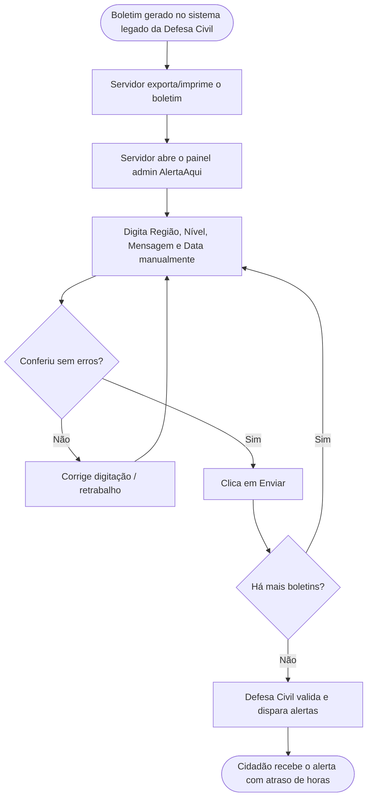
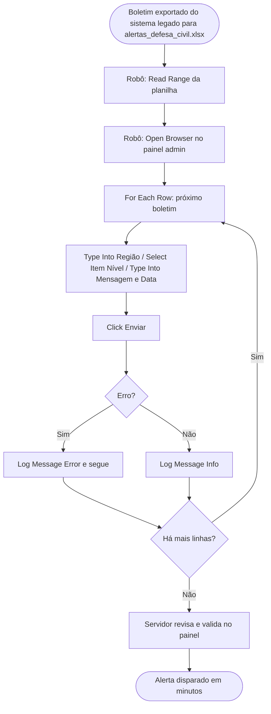

# AlertaAqui — Automação RPA (UiPath)

**Disciplina:** RPA (UiPath) — FIAP · **Produto:** AlertaAqui — alerta de enchente e onda de calor por endereço; a Defesa Civil valida e dispara os alertas em um painel admin.

**Integrantes:**

| Nome completo | RM |
|---|---|
| Kaio Vinicius Meireles Alves | 553282 |
| Lucas Alves de Souza | 553956 |
| Guilherme Fernandes de Freitas | 554323 |
| João Pedro Chizzolini de Freitas | 553172 |
| Henrique Rafael | 553945 |

**Repositório:** https://github.com/Martyzaum/GS-RPA

---

## 1. Processo escolhido

**Robô "Cadastrador de Boletins":** lê a planilha `alertas_defesa_civil.xlsx` (colunas **Regiao, NivelRisco, Mensagem, Data**), que simula os boletins exportados por um **sistema legado da Defesa Civil sem API**, e **cadastra cada alerta no formulário web do painel admin** do MVP AlertaAqui (`form.html`).

| Item | Descrição |
|---|---|
| Entrada | `alertas_defesa_civil.xlsx`, aba `Alertas` (exportação diária/por evento do sistema legado) |
| Saída | Alertas cadastrados no painel admin (lista "Alertas enviados") + log de execução |
| Gatilho | Manual (assistido) ou agendado via Orchestrator a cada chegada de boletim |
| Atividades UiPath | Read Range (workbook), Open Browser, For Each Row, Try Catch, Type Into, Select Item, Click, Log Message |
| Tratamento de exceção | Linha com falha é registrada (Log Message nível *Error*) e o robô segue para o próximo boletim |

**Por que esse processo?** Hoje um servidor da Defesa Civil copia, boletim por boletim, os dados do sistema legado para o painel. É repetitivo, sujeito a erro de digitação e atrasa o disparo do alerta — e em enchente, minutos importam.

---

## 2. Assessment de automação

Escala: 1 (desfavorável) a 5 (muito favorável à automação).

| Critério | Avaliação | Nota |
|---|---|---|
| Volume / frequência | ~20 boletins/dia, picos em temporada de chuva (nov–mar) e ondas de calor | 4 |
| Regras claras | Mapeamento 1:1 coluna → campo, sem julgamento humano na digitação | 5 |
| Estabilidade do processo / tela | Formulário próprio do MVP com IDs fixos (`regiao`, `nivel`, `mensagem`, `data`, `btnEnviar`); planilha com layout padronizado | 4 |
| Dados estruturados e digitais | Planilha Excel com 4 colunas tipadas; nada em papel ou imagem | 5 |
| Exceções | Poucas e previsíveis (campo vazio, nível inválido, tela fora do ar) → tratadas no Try Catch | 4 |
| Impacto | Reduz tempo até o disparo do alerta (vidas e patrimônio) e libera servidores para validação | 5 |
| **Total** | | **27 / 30 (90%)** |

**Conclusão: processo APTO PARA RPA.** Alta pontuação em regras, dados estruturados e impacto; a única ressalva (dependência da tela) é mitigada por seletores estáveis por `id`.

---

## 3. Diagnóstico: RPA vs API

| Aspecto | Situação |
|---|---|
| Sistema de origem (Defesa Civil) | **Legado, sem API**; só exporta planilha/relatório → integração por API é inviável hoje |
| Sistema de destino (painel AlertaAqui) | MVP com formulário web; API REST ainda não publicada |
| Decisão | **RPA agora**: entrega valor imediato, sem alterar o sistema legado (que não é nosso) |

**Roadmap de migração (RPA → API):**

1. **Fase 1 (agora):** robô UiPath lê a planilha e preenche o formulário (UI automation).
2. **Fase 2 (MVP v2):** AlertaAqui publica `POST /api/alertas`; o robô passa a usar **HTTP Request** em vez da tela (mais rápido e sem dependência de seletores).
3. **Fase 3:** quando a Defesa Civil modernizar o sistema (ou expuser webhook/arquivo em pasta monitorada), integração direta sistema-a-sistema; o robô é aposentado ou vira apenas monitor de exceções.

RPA aqui é **ponte tática**, não arquitetura definitiva.

---

## 4. BPM — As-Is (processo atual, manual)

**Dores:** ~8 min por boletim, erros de digitação (região errada = alerta para o bairro errado), fila acumulada em dias de chuva forte.

## 5. BPM — To-Be (com robô UiPath)

**Ganhos:** ~30 s por boletim pelo robô, zero erro de digitação, servidor foca na **validação** (decisão humana) e não na digitação.

---

## 6. Business case

> **Atenção: todos os números abaixo são PREMISSAS / ESTIMATIVAS** de mercado para fins acadêmicos, não dados oficiais da Defesa Civil.

| Premissa (estimativa) | Valor |
|---|---|
| Boletins por mês | 600 (≈ 20/dia) — *premissa* |
| Tempo de cadastro manual por boletim (digitar + conferir) | 8 min — *premissa* |
| Custo/hora de servidor público com encargos | R$ 60,00 — *estimativa* |
| Taxa de erro de digitação | 3% — *premissa* |
| Tempo de retrabalho por erro | 15 min — *premissa* |
| Licença UiPath produção (robô + Orchestrator, rateado) | ≈ R$ 25.000/ano — *estimativa* |
| Infraestrutura (VM para o robô) | ≈ R$ 300/mês — *estimativa* |

**Cálculo (cenário manual):**

| Item | Conta | Resultado |
|---|---|---|
| Horas de digitação/mês | 600 × 8 min = 4.800 min | **80 h** |
| Horas de retrabalho/mês | 600 × 3% = 18 erros × 15 min | **4,5 h** |
| Total horas manuais/mês | 80 + 4,5 | **84,5 h** |
| Custo manual/mês | 84,5 h × R$ 60 | **R$ 5.070** |
| Custo manual/ano | R$ 5.070 × 12 | **R$ 60.840** |

**Custo da automação (ano):** licença ≈ R$ 25.000 + infra R$ 3.600 = **≈ R$ 28.600/ano** (estimativa).

| Indicador | Valor |
|---|---|
| Economia bruta anual | R$ 60.840 |
| Economia líquida anual | **≈ R$ 32.240** |
| ROI ano 1 | ≈ 113% |
| Payback | ≈ 5,6 meses |
| Horas liberadas por mês | ≈ 84 h (≈ meio servidor dedicado) |

- **UiPath Community Edition é gratuita** para estudo, uso pessoal e pequenas equipes — o protótipo deste trabalho custou **R$ 0** em licença.
- Benefício não monetizado (o mais importante): **tempo até o alerta cair de horas para minutos** e eliminação de alertas enviados para a região errada.

---

## 7. Roteiro do vídeo (3 min)

| Tempo | Bloco | Fala / tela |
|---|---|---|
| 0:00–0:30 | **Problema** | "Em novembro, bairros como Jardim Pantanal e Itaim Paulista alagam todo ano. A Defesa Civil emite boletins, mas eles saem de um sistema antigo, sem API. Alguém precisa digitar tudo no painel do AlertaAqui — e cada minuto de atraso é um morador que não foi avisado." (tela: logo AlertaAqui + foto/mapa de alagamento) |
| 0:30–1:00 | **Processo As-Is** | "Hoje é assim: o servidor exporta o boletim, abre o painel e digita região, nível, mensagem e data, um por um. São cerca de 8 minutos por boletim, com erro de digitação." (tela: diagrama As-Is) |
| 1:00–2:00 | **Demo do robô** | "Esta é a planilha com 10 boletins. Aperto Run no UiPath…" (tela: Studio → Run; Chrome abre o form.html; campos sendo preenchidos sozinhos; lista 'Alertas enviados' crescendo até 10; painel Output com os Log Messages). "O robô lê a planilha com Read Range, percorre cada linha e preenche o formulário. Se uma linha der erro, ele registra no log e segue." |
| 2:00–2:40 | **To-Be e ganhos** | "No To-Be, o servidor só valida. Pelas nossas premissas — 600 boletins/mês, 8 minutos cada, R$ 60/hora — são 84 horas e cerca de R$ 60 mil por ano em digitação; com licença estimada, economia líquida de ~R$ 32 mil/ano e payback em ~6 meses. E o alerta sai em minutos." (tela: diagrama To-Be + tabela business case) |
| 2:40–3:00 | **Fechamento** | "Assessment: 27 de 30, apto para RPA. É a ponte até o AlertaAqui ter API própria — aí o robô migra para HTTP Request. AlertaAqui: o alerta certo, no lugar certo, na hora certa." (tela: roadmap + logo) |

---

## 8. Passo a passo no UiPath Studio (5 minutos) — Plano B

> **Importante:** o `Main.xaml` deste pacote foi escrito à mão (sem o Studio disponível no momento da geração) e **não pôde ser testado**. Ele segue o formato Windows-Legacy com atividades clássicas, mas se o Studio acusar erro ao abrir, **monte do zero seguindo exatamente os passos abaixo** (≈ 5 min).

**Preparação**

1. Abra o UiPath Studio → **New Project → Process** → Nome `AlertaAquiRPA` → Compatibility **Windows - Legacy** (ou **Windows**), linguagem **VB**.
2. Copie `alertas_defesa_civil.xlsx` e `form.html` para a pasta do projeto.
3. **Manage Packages**: confirme `UiPath.System.Activities`, `UiPath.UIAutomation.Activities`, `UiPath.Excel.Activities`. Instale a extensão do Chrome do UiPath (Home → Tools → Chrome Extension) se ainda não tiver.
4. Abra `form.html` uma vez no Chrome manualmente para garantir que abre.

**Variáveis (painel Variables, escopo Main)**

| Nome | Tipo | Default |
|---|---|---|
| `dtAlertas` | DataTable | — |
| `urlForm` | String | — |
| `qtdOk` | Int32 | 0 |
| `qtdErro` | Int32 | 0 |

**Atividades (na ordem, dentro da Sequence Main)**

1. **Assign** → To: `urlForm` · Value: `"file:///" + System.IO.Path.GetFullPath("form.html").Replace("\", "/")`
2. **Read Range** (categoria *App Integration → Excel → Workbook*, **sem** Excel Application Scope) → WorkbookPath: `"alertas_defesa_civil.xlsx"` · SheetName: `"Alertas"` · Range: `""` · AddHeaders: ✔ · Output DataTable: `dtAlertas`
3. **Log Message** → Level: Info · Message: `"Boletins lidos: " + dtAlertas.Rows.Count.ToString`
4. **Open Browser** → Url: `urlForm` · BrowserType: `Chrome` · NewSession: ✔. Dentro do **Do**:
   1. **For Each Row** → ForEach: `row` · In: `dtAlertas`. Dentro do **Body**:
      1. **Try Catch**. No **Try**, uma Sequence com:
         - **Type Into** → Text: `row("Regiao").ToString.Trim` · EmptyField ✔ · SimulateType ✔ · Selector: `<html app='chrome.exe' title='AlertaAqui*' /><webctrl id='regiao' tag='INPUT' />`
         - **Select Item** → Item: `row("NivelRisco").ToString.Trim` · Selector: `<html app='chrome.exe' title='AlertaAqui*' /><webctrl id='nivel' tag='SELECT' />`
         - **Type Into** → Text: `row("Mensagem").ToString.Trim` · EmptyField ✔ · SimulateType ✔ · Selector: `<html app='chrome.exe' title='AlertaAqui*' /><webctrl id='mensagem' tag='TEXTAREA' />`
         - **Type Into** (data) → Text: `Convert.ToDateTime(row("Data")).ToString("ddMMyyyy")` · SimulateType **desmarcado** (campo `date` precisa de digitação "hardware") · EmptyField desmarcado · Selector: `<html app='chrome.exe' title='AlertaAqui*' /><webctrl id='data' tag='INPUT' />`
         - **Click** → SimulateClick ✔ · Selector: `<html app='chrome.exe' title='AlertaAqui*' /><webctrl id='btnEnviar' tag='BUTTON' />`
         - **Assign** → `qtdOk` = `qtdOk + 1`
         - **Log Message** → Info · `"Alerta cadastrado: " + row("Regiao").ToString + " | " + row("NivelRisco").ToString`
      2. Em **Catches** → Add new catch → **System.Exception**, com:
         - **Assign** → `qtdErro` = `qtdErro + 1`
         - **Log Message** → Level: **Error** · Message: `"Falha ao cadastrar alerta da regiao " + row("Regiao").ToString + ": " + exception.Message`
5. **Log Message** (fora do Open Browser) → Info · `"AlertaAqui RPA finalizado. Sucesso: " + qtdOk.ToString + " | Erros: " + qtdErro.ToString`

**Dicas rápidas**

- Atalho: em vez de digitar os seletores, use **Indicate on screen** em cada campo e depois confira no **Selector Editor** que só restaram `id` e `tag`.
- Se o campo Data ficar vazio (Chrome em inglês usa mm/dd/aaaa), troque o formato para `"MMddyyyy"`.
- Rode com **Run (Ctrl+F5)**; resultado esperado: 10 alertas na lista "Alertas enviados" e `Sucesso: 10 | Erros: 0` no painel Output.
- Para testar o Catch: apague um valor de nível na planilha → a validação não grava aquela linha; ou altere um seletor para forçar timeout e ver o Log *Error*.

---

## 9. Arquivos entregues

- `alertas_defesa_civil.xlsx` / `.csv` — 10 boletins de exemplo (regiões de SP, novembro/2026)
- `form.html` — painel admin simulado (IDs estáveis para seletores, persistência em localStorage)
- `UiPath/AlertaAquiRPA/project.json` + `Main.xaml` — projeto UiPath (com cópias da planilha e do form)
- `docs/rpa.md` / `docs/rpa.pdf` — esta documentação
